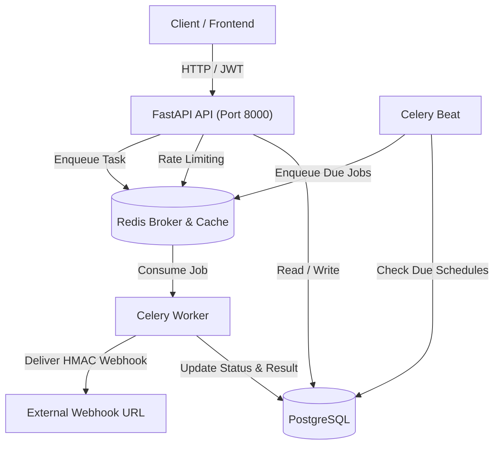

# TaskPulse

TaskPulse is a background job scheduling and asynchronous task execution API built with Python, FastAPI, SQLAlchemy, Redis, and Celery. It provides authenticated job dispatching, scheduled recurrence (via cron expressions and intervals), Redis-based rate limiting, and webhook notifications with exponential backoff retries.

## Features

- **Job Lifecycle Management**: Enqueue background tasks with status tracking through `queued`, `running`, `succeeded`, `failed`, and `cancelled` states. Supports manual retry and cancellation.
- **Built-in Task Handlers**: Out-of-the-box handlers for HTTP requests, data processing (aggregations, sorting, word counts), mock notification dispatch, and long-running operations.
- **Recurring Schedules**: Define recurrence using 5-field cron syntax (`0 * * * *`) or fixed intervals (`interval_seconds`). Celery Beat periodically queries active schedules and enqueues due jobs.
- **Webhook Delivery with Retries**: Automatically sends HMAC-SHA256 signed event payloads to registered webhook endpoints upon job state transitions. Unsuccessful deliveries automatically retry up to 3 times with exponential backoff (1s, 2s, 4s).
- **JWT Authentication**: User registration and token-based authentication using bcrypt password hashing and HS256 JWT tokens.
- **Redis Rate Limiting**: Per-client / per-token rate limiter backed by Redis with `Retry-After` and `X-RateLimit-*` headers.
- **Database Migrations with Composite Indexes**: Alembic migrations targeting PostgreSQL with composite indexes on high-cardinality query patterns (`user_id + status`, `user_id + created_at`, `status + created_at`, `is_active + next_run_at`, and `webhook_id + created_at`).

## Architecture



## Tech Stack

- **Language & Runtime**: Python 3.11
- **Web Framework**: FastAPI, Pydantic v2
- **Database & ORM**: PostgreSQL, SQLAlchemy 2.0, Alembic
- **Distributed Queue**: Celery 5.3+, Redis 7
- **HTTP & Utilities**: HTTPX, Croniter, PyJWT, Bcrypt
- **Containerization**: Docker, Docker Compose
- **Testing & CI**: PyTest, PyTest-Cov, Fakeredis, GitHub Actions

## Project Structure

```
TaskPulse/
├── alembic/                    # Database migrations
│   ├── versions/
│   │   └── 0001_initial_schema.py
│   └── env.py
├── app/
│   ├── api/                    # Route handlers and dependencies
│   │   ├── deps.py             # Auth & DB dependencies
│   │   └── v1/
│   │       ├── auth.py         # /api/v1/auth
│   │       ├── jobs.py         # /api/v1/jobs
│   │       ├── schedules.py    # /api/v1/schedules
│   │       ├── webhooks.py     # /api/v1/webhooks
│   │       └── health.py       # /health and /api/v1/health
│   ├── core/                   # Security, Redis client, Celery instance, Rate limiting
│   ├── models/                 # SQLAlchemy 2.0 ORM models
│   ├── schemas/                # Pydantic v2 validation models
│   ├── worker/                 # Task handlers, Celery tasks, webhook dispatcher
│   ├── config.py               # Pydantic BaseSettings
│   ├── database.py             # Engine & sessionmaker
│   └── main.py                 # FastAPI application root
├── tests/                      # Unit & integration test suite (94 tests)
├── .github/workflows/ci.yml    # GitHub Actions workflow
├── docker-compose.yml          # Compose file (api, worker, beat, postgres, redis)
├── Dockerfile                  # Container definition
├── requirements.txt
└── pyproject.toml
```

## Running with Docker Compose

To start all services (`api`, `worker`, `beat`, `postgres`, `redis`):

```bash
docker compose up --build
```

The services will start up:
- FastAPI API: `http://localhost:8000`
- Interactive OpenAPI docs: `http://localhost:8000/docs`
- Health endpoint: `http://localhost:8000/health`

To stop the containers:

```bash
docker compose down
```

## Local Development (Without Docker)

You can run the API directly on your host machine. By default, it falls back to a local SQLite database (`taskpulse.db`) if no PostgreSQL connection is configured.

1. **Create and activate a virtual environment**:
   ```bash
   python3 -m venv .venv
   source .venv/bin/activate
   ```

2. **Install dependencies**:
   ```bash
   pip install -r requirements.txt
   ```

3. **Configure environment variables**:
   ```bash
   cp .env.example .env
   ```

4. **Run database migrations**:
   ```bash
   alembic upgrade head
   ```

5. **Start the API server**:
   ```bash
   uvicorn app.main:app --host 0.0.0.0 --port 8000 --reload
   ```

6. **Start the Celery worker and beat (requires Redis)**:
   ```bash
   celery -A app.core.celery_app.celery_app worker --loglevel=info
   celery -A app.core.celery_app.celery_app beat --loglevel=info
   ```

## Running Tests

The test suite uses SQLite in-memory tables and FakeRedis, so no Docker, external database, or running Redis instance is required to execute tests.

Run the test suite with coverage:

```bash
pytest --cov=app --cov-report=term-missing
```

Measured test output:
```
======================= 94 passed in 22.74s =======================
Coverage: 95% total coverage across all app modules
```

## API Endpoints

### Authentication
- `POST /api/v1/auth/register` - Create a user account
- `POST /api/v1/auth/login` - Authenticate and receive a Bearer JWT
- `GET /api/v1/auth/me` - Get profile for current authenticated user

### Jobs
- `POST /api/v1/jobs` - Enqueue a new background job
- `GET /api/v1/jobs` - List jobs for current user (filter by `status`, `job_type`, pagination)
- `GET /api/v1/jobs/{job_id}` - Retrieve details, logs, and result for a job
- `POST /api/v1/jobs/{job_id}/cancel` - Cancel a queued or running job
- `POST /api/v1/jobs/{job_id}/retry` - Re-enqueue a failed or cancelled job
- `DELETE /api/v1/jobs/{job_id}` - Remove a job record

### Schedules
- `POST /api/v1/schedules` - Create a recurring schedule (cron expression or interval)
- `GET /api/v1/schedules` - List all schedules configured by user
- `GET /api/v1/schedules/{schedule_id}` - Get schedule details
- `PATCH /api/v1/schedules/{schedule_id}` - Update schedule settings or pause (`is_active: false`)
- `DELETE /api/v1/schedules/{schedule_id}` - Delete a schedule
- `POST /api/v1/schedules/{schedule_id}/trigger` - Trigger an immediate job execution from schedule

### Webhooks
- `POST /api/v1/webhooks` - Register a webhook URL for job events (`job.succeeded`, `job.failed`, `*`)
- `GET /api/v1/webhooks` - List registered webhooks
- `GET /api/v1/webhooks/{webhook_id}` - Get webhook registration
- `DELETE /api/v1/webhooks/{webhook_id}` - Delete webhook
- `POST /api/v1/webhooks/{webhook_id}/test` - Dispatch a test ping event
- `GET /api/v1/webhooks/{webhook_id}/deliveries` - List delivery attempts and response history

### Health
- `GET /health` - Lightweight liveness probe
- `GET /api/v1/health` - Health inspection reporting PostgreSQL and Redis connectivity

## Usage Examples

### 1. Register and Log In
```bash
# Register
curl -X POST http://localhost:8000/api/v1/auth/register \
  -H "Content-Type: application/json" \
  -d '{"email": "alice@example.com", "password": "securepassword123", "full_name": "Alice"}'

# Login
curl -X POST http://localhost:8000/api/v1/auth/login \
  -H "Content-Type: application/json" \
  -d '{"email": "alice@example.com", "password": "securepassword123"}'
```

Response:
```json
{
  "access_token": "eyJhbGciOi...",
  "token_type": "bearer",
  "expires_in": 3600
}
```

### 2. Enqueue a Job
```bash
TOKEN="<your_jwt_token>"

curl -X POST http://localhost:8000/api/v1/jobs \
  -H "Authorization: Bearer $TOKEN" \
  -H "Content-Type: application/json" \
  -d '{
    "job_type": "data_processing",
    "payload": {
      "action": "sum",
      "data": [10, 20, 30, 40]
    },
    "priority": 1,
    "max_retries": 3
  }'
```

### 3. Create a Recurring Cron Schedule
```bash
curl -X POST http://localhost:8000/api/v1/schedules \
  -H "Authorization: Bearer $TOKEN" \
  -H "Content-Type: application/json" \
  -d '{
    "name": "Hourly Ping",
    "job_type": "http_request",
    "payload": {"url": "https://httpbin.org/status/200", "method": "GET"},
    "cron_expression": "0 * * * *"
  }'
```

### 4. Register a Webhook Endpoint
```bash
curl -X POST http://localhost:8000/api/v1/webhooks \
  -H "Authorization: Bearer $TOKEN" \
  -H "Content-Type: application/json" \
  -d '{
    "url": "https://webhook.site/your-unique-url",
    "event_types": ["job.succeeded", "job.failed"]
  }'
```

Every delivery payload includes signature headers:
```
X-TaskPulse-Event: job.succeeded
X-TaskPulse-Timestamp: 1793280000
X-TaskPulse-Signature: sha256=4f5b21...
```

Verify signature in Python:
```python
import hmac, hashlib

expected = hmac.new(secret.encode(), raw_body.encode(), hashlib.sha256).hexdigest()
is_valid = hmac.compare_digest(f"sha256={expected}", request_headers["X-TaskPulse-Signature"])
```

## What I'd Improve Next

1. **Dead Letter Queue (DLQ)**: Add an explicit DLQ dashboard and storage table for poisoned tasks that exceed their retry budget to allow manual inspection and replay.
2. **WebSocket Subscriptions**: Expose WebSocket endpoints for streaming real-time job status transitions directly to browser clients instead of polling `GET /jobs/{id}`.
3. **Workflow DAGs / Task Chaining**: Support multi-step dependent pipelines (e.g. step A generates output, which feeds into step B and step C in parallel) using Celery canvas primitives (`chain`, `group`, `chord`).
4. **Custom Worker Plugins**: Allow users to register containerized runners or sandboxed Python functions rather than only predefined task types.
